# Modelo entidad-relación — LaSobremesa

Modelo relacional del Hito 3. El diagrama refleja las tablas y claves foráneas definidas en `script.sql`.

```mermaid
erDiagram
    usuarios {
        INT id PK
        VARCHAR_100 nombre
        VARCHAR_100 apellido
        VARCHAR_190 email
        VARCHAR_30 telefono
        VARCHAR_255 password_hash
        ENUM rol
        BOOLEAN email_verificado
        TIMESTAMP creado_en
    }
    categorias {
        INT id PK
        VARCHAR_120 nombre
    }
    proveedores {
        INT id PK
        VARCHAR_150 nombre
        TEXT descripcion
        VARCHAR_190 email
        VARCHAR_30 telefono
        INT usuario_id FK
    }
    productos {
        INT id PK
        INT categoria_id FK
        INT proveedor_id FK
        VARCHAR_180 nombre
        TEXT descripcion
        TEXT ingredientes
        TEXT valor_nutricional
        VARCHAR_50 tipo_conservacion
        DATE fecha_vencimiento
        DECIMAL_12_2 precio
        DECIMAL_5_2 descuento
        VARCHAR_500 imagen
        INT stock_cantidad
        INT stock_minimo
        BOOLEAN favorito
        BOOLEAN activo
    }
    direcciones {
        INT id PK
        INT usuario_id FK
        VARCHAR_150 nombre_receptor
        VARCHAR_30 telefono
        VARCHAR_180 calle
        VARCHAR_30 numero
        VARCHAR_120 comuna
        VARCHAR_120 ciudad
        VARCHAR_120 region
        TEXT instrucciones
        BOOLEAN es_predeterminada
    }
    carritos {
        INT id PK
        INT usuario_id FK
        TIMESTAMP creado_en
    }
    carrito_items {
        INT id PK
        INT carrito_id FK
        INT producto_id FK
        INT cantidad
    }
    metodos_entrega {
        INT id PK
        VARCHAR_120 nombre
        DECIMAL_12_2 precio
    }
    pedidos {
        INT id PK
        INT usuario_id FK
        INT direccion_id FK
        INT metodo_entrega_id FK
        ENUM estado
        DECIMAL_12_2 total
        TIMESTAMP creado_en
    }
    pedido_items {
        INT id PK
        INT pedido_id FK
        INT producto_id FK
        VARCHAR_180 nombre_producto
        DECIMAL_12_2 precio_unitario
        INT cantidad
        DECIMAL_12_2 subtotal
    }
    historial_estados_pedido {
        INT id PK
        INT pedido_id FK
        VARCHAR_30 estado
        TIMESTAMP fecha
    }
    zonas_despacho {
        INT id PK
        VARCHAR_120 nombre
    }
    despachos {
        INT id PK
        INT pedido_id FK
        INT zona_id FK
        VARCHAR_40 estado
        VARCHAR_120 codigo_seguimiento
    }
    seguimientos_despacho {
        INT id PK
        INT despacho_id FK
        VARCHAR_40 estado
        TEXT detalle
        TIMESTAMP fecha
    }
    resenas {
        INT id PK
        INT usuario_id FK
        INT producto_id FK
        VARCHAR_180 titulo
        TINYINT estrellas
        TEXT detalle
    }
    favoritos {
        INT usuario_id PK, FK
        INT producto_id PK, FK
    }
    suscripciones {
        INT id PK
        VARCHAR_150 nombre
        TEXT descripcion
        DECIMAL_12_2 precio
        BOOLEAN activa
    }
    suscripcion_productos {
        INT suscripcion_id PK, FK
        INT producto_id PK, FK
        INT cantidad
    }
    suscripciones_usuarios {
        INT id PK
        INT usuario_id FK
        INT suscripcion_id FK
        TIMESTAMP fecha_inicio
        VARCHAR_30 estado
    }
    metodos_pago {
        INT id PK
        INT usuario_id FK
        VARCHAR_80 proveedor_pago
        VARCHAR_255 token_referencia
        VARCHAR_40 marca
        CHAR_4 ultimos_cuatro
        TINYINT vencimiento_mes
        SMALLINT vencimiento_anio
        BOOLEAN es_predeterminado
    }
    pagos {
        INT id PK
        INT pedido_id FK
        INT metodo_pago_id FK
        DECIMAL_12_2 monto
        VARCHAR_40 estado
        VARCHAR_190 referencia_externa
        TIMESTAMP creado_en
    }
    datos_facturacion {
        INT id PK
        INT pedido_id FK
        VARCHAR_180 razon_social
        VARCHAR_20 rut
        VARCHAR_180 giro
        TEXT direccion
    }
    tokens_recuperacion {
        INT id PK
        INT usuario_id FK
        VARCHAR_255 token_hash
        DATETIME expira_en
        DATETIME usado_en
    }
    usuarios ||--o| proveedores : "usuario_id"
    categorias ||--o{ productos : "categoria_id"
    proveedores ||--o{ productos : "proveedor_id"
    usuarios ||--o{ direcciones : "usuario_id"
    usuarios ||--o| carritos : "usuario_id"
    carritos ||--o{ carrito_items : "carrito_id"
    productos ||--o{ carrito_items : "producto_id"
    usuarios ||--o{ pedidos : "usuario_id"
    direcciones ||--o{ pedidos : "direccion_id"
    metodos_entrega ||--o{ pedidos : "metodo_entrega_id"
    pedidos ||--o{ pedido_items : "pedido_id"
    productos ||--o{ pedido_items : "producto_id"
    pedidos ||--o{ historial_estados_pedido : "pedido_id"
    pedidos ||--o| despachos : "pedido_id"
    zonas_despacho ||--o{ despachos : "zona_id"
    despachos ||--o{ seguimientos_despacho : "despacho_id"
    usuarios ||--o{ resenas : "usuario_id"
    productos ||--o{ resenas : "producto_id"
    usuarios ||--o{ favoritos : "usuario_id"
    productos ||--o{ favoritos : "producto_id"
    suscripciones ||--o{ suscripcion_productos : "suscripcion_id"
    productos ||--o{ suscripcion_productos : "producto_id"
    usuarios ||--o{ suscripciones_usuarios : "usuario_id"
    suscripciones ||--o{ suscripciones_usuarios : "suscripcion_id"
    usuarios ||--o{ metodos_pago : "usuario_id"
    pedidos ||--o{ pagos : "pedido_id"
    metodos_pago ||--o{ pagos : "metodo_pago_id"
    pedidos ||--o| datos_facturacion : "pedido_id"
    usuarios ||--o{ tokens_recuperacion : "usuario_id"
```

## Convenciones

- Las relaciones se implementan mediante claves foráneas, no mediante listas de identificadores.
- `carrito_items` y `pedido_items` representan los productos asociados a carritos y pedidos.
- `favoritos` representa favoritos por usuario y utiliza una clave primaria compuesta.
- `productos.favorito` indica si la tienda destaca un producto; es independiente de la tabla `favoritos`.
- `suscripcion_productos` utiliza una clave primaria compuesta.
- Los métodos de pago almacenan referencias tokenizadas; no se guarda el CVV.
- `resenas.estrellas` permite calcular la valoración promedio de cada producto.
- Las cardinalidades representan las restricciones SQL, no necesariamente todas las reglas de negocio.
